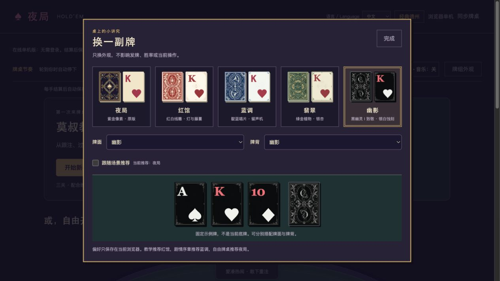
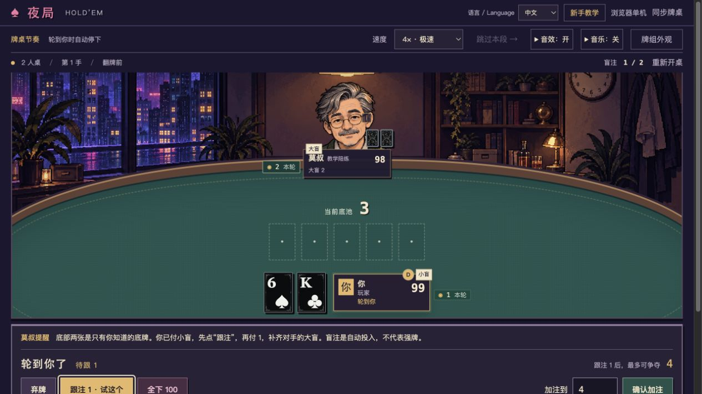
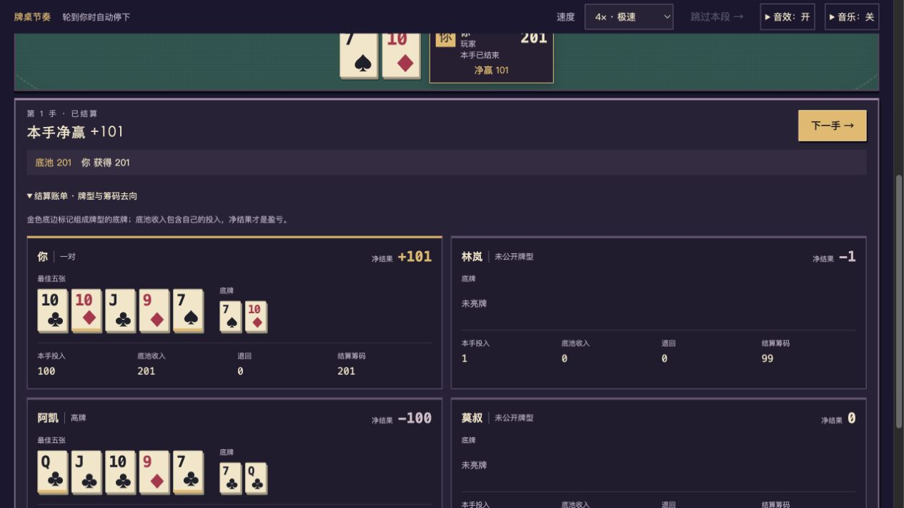
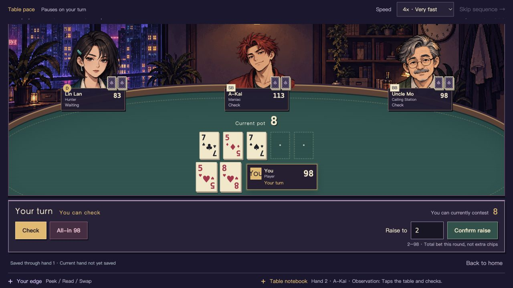
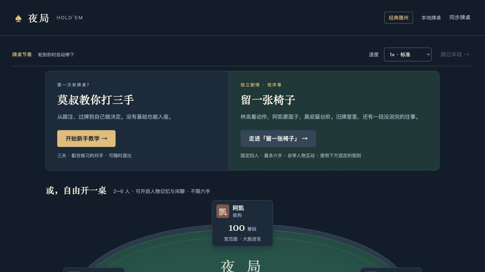
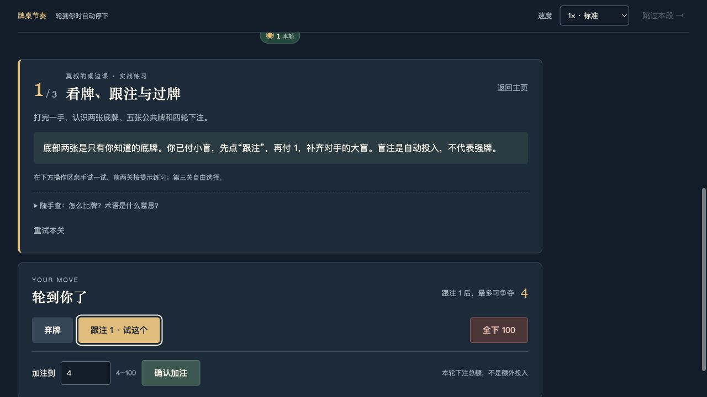
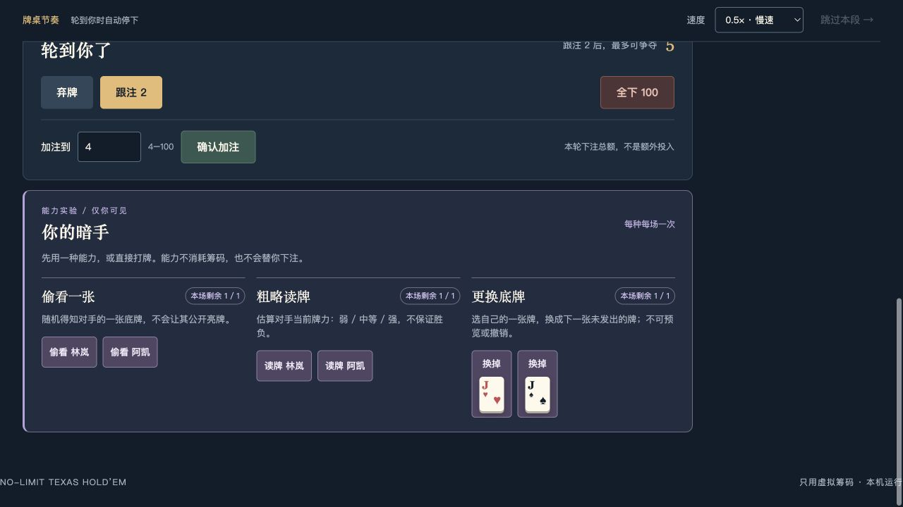

# Holdem Game Engine — Night Table

[English](README.en.md) · [简体中文](README.md)

A TypeScript No-Limit Texas Hold'em engine with a playable, pixel-art single-player table. Meet distinct opponents, learn the rules at the table, or try three optional cheating abilities.

**[Play in English →](https://amatate.github.io/holdem-game-engine/?lang=en)** · [Play in Chinese](https://amatate.github.io/holdem-game-engine/?lang=zh) · [Deployment status](https://github.com/amatate/holdem-game-engine/actions/workflows/pages.yml)

No download, account, or API key. Virtual chips only: no deposits, withdrawals, or real-money betting. This is a single-player prototype, not online multiplayer.

## Volume One: A Seat Kept

The home screen now opens a continuous six-night story, with optional real Hold’em tables and five ending directions. Volume One’s literary text is currently **Chinese**; the English interface, classic tables, tutorials and legacy story remain available.

Night One uses score chips that never enter the wallet. From Night Two, buy-ins and cash-outs use actual engine results. Accepting 150, retaining an unpaid promise and declining a money arrangement lead to different records. Photos, witnesses and invitations require the corresponding player choices. Winning or using an ability is never required to finish the story.

Starting a new volume replaces the story-journey slot after confirmation. Free play and the legacy First Night have separate saves. Recognized legacy story builds still require deterministic replay and digest verification; old events are not rewritten as the new story.

See the [integration notes](docs/playtests/volume-one-v2.md) and [approved Chinese manuscript](docs/writing-review-v2/02-夜局第一卷_完整文字稿_v2.md).

## Competitive AI laboratory v0 (local only)

An independent evaluation harness for the existing heuristics. Ordinary NPC policies are unchanged; an optional browser Competitive practice entry now uses the same challenge baseline, not a newly trained or GTO agent.

```bash
npm run ai:arena -- --blocks 100 --samples 300 --seed eval-v0-a
```

This command runs 200 heads-up hands in 100 independent, seat-swapped deal blocks. JSON and Markdown reports include net `bb/100`, uncertainty, illegal actions, timeouts, latency and source fingerprints. Also supports 2–6 players and local escalating-blind tournaments. This evaluation command makes no network requests. [Usage and limitations](docs/competitive-ai-v0.md).

An experimental **ChipZen remote adapter** is available separately: `npm run ai:chipzen -- --standby` maintains lobby presence and reconnects after transient failures; `--status` reads local connection health. Standby never creates or joins matches. Stop it with Ctrl+C before running `--practice` for exactly one unrated house-bot match. `--check` only validates configuration. It uses the official protocol / pinned SDK, isolated decision workers and redacted local logs. No automatic ranked entry, tournament registration or upload. **Offline protocol tests pass; a completed online match and any strength improvement remain unverified.** Configure credentials locally using `.env.chipzen.example`; never commit the token. [Integration and evaluation guide](docs/chipzen-integration.md).

## Mobile frontend v1 (local, not deployed)

A separate portrait composition adds an illustrated game home, a 2–6 player table that fits the viewport, a raise drawer, tap-to-open character profiles, notebook and ability panels, and dialogue scenes shown one line at a time. Wager controls use the engine's legal total-bet range. Chapter tables show their real settlement before the next conversation.

Narrow screens switch automatically. Add `?ui=mobile&lang=en` to preview the phone interface on desktop, or `?ui=desktop` to keep the original desktop UI. Start with `HOLDEM_PORT=4196 npm run web`, then open [the mobile preview](http://127.0.0.1:4196/?ui=mobile&lang=en). This remains a browser frontend; native app packaging and the public Pages deployment are pending. Existing save-version checks remain in place: older records are retained, but cross-version migration is not implemented.

## First Night · Local update (2026-10-26, not deployed)

Enter **First Night** from home: wait with Mo, play a four-handed table, then choose whether to stay for a duel with Lin. The three tables last up to 4 / 6 / 6 hands, each with a fresh 100-chip buy-in and fixed 1/2 blinds. A score sheet records real results. Leaving after a settled hand is valid; winning is never required to advance.

Play as an ordinary player, or bring just Peek, Read or Swap. Start with 3 energy; costs are 2 / 1 / 2, once per table. Rest between tables to recover 1, capped at 3. Returning NPCs retain only public actions they witnessed. The chapter has a separate save, authored English dialogue and a mobile layout. A later invitation ends the demo; the betrayal arc belongs to future chapters.

Run `npm run web` for [local play](http://127.0.0.1:4173/), or `HOLDEM_PORT=4194 npm run web` to select another port. For the browser-only build, run `npm run build:pages && npm run preview:pages` and open [the local Pages preview](http://127.0.0.1:4182/holdem-game-engine/). These changes have not been pushed or deployed.

## Local development · 2026-10-13 (not deployed to the live demo yet)

- **Denomination-aware stacks:** original, individually rendered chips informed by the [Replay Poker design team's public case study](https://supereightstudio.com/project_replaypoker), with no copied artwork. Amounts break into coloured denominations such as 1, 5, 25 and 100: 20 is four 5s; 137 is six chips. Rims and engravings follow the five card-back themes. Open **Deck style** to compare 2, 20 and 137. Earlier decorative chip images remain entrance artwork, not table-money symbols. [Original decorative assets and prompts](src/web/art/chips-v1.json).
- **Competitive practice:** choose **Enter competitive practice** on the homepage. Heads-up against Lin Lan, 200 chips each (initially 100BB), 1/2 blinds rising on the existing ladder every 8 hands, until one player is eliminated. Uses the arena's `hunter-challenge` policy with 600 samples per decision. No abilities or cross-hand social memory; all existing modes remain available.
- **Continue your match:** settlement, next hand, bilingual UI and local/browser checkpoints work in this mode. Single-player practice, not a Chipzen client or cheat-resistant ranked game. Older-build saves may be incompatible; they are retained until a new table settles.

From the project directory, run `npm run web` for the Node edition (default `http://127.0.0.1:4173/`). For the static edition, run `npm run build:pages` then `npm run preview:pages` (default `http://127.0.0.1:4182/holdem-game-engine/`).

## Published updates · 2026-10-05

- **Five deck styles:** Night Table, Lantern Club, Blue Hour, Jade Salon, and Wraith. Open **Deck style** to switch a whole set or mix faces and backs. Preferences stay in your browser; optional scene recommendations use Lantern Club for lessons and Blue Hour for the prologue. Manual choices take priority.
- **Wraith tribute:** a Black Ghost I-inspired black-and-white direction with original crescent-and-ribbon engraving, silver-white pips and red ranks for hearts/diamonds. Not an official deck or exact reproduction. All card values remain code-rendered; illustrated court cards are not implemented. [Assets, references and full prompts](src/web/art/README.md).
- **Readable cards and results:** 10 instead of T, grouped best-five cards, gold edges identifying used hole cards, and per-player accounting for contributions, pot winnings, returns and net results.
- **Seven illustrated opponents:** neutral, speaking and public-award poses, character-based dialogue, and hover/focus/tap profiles showing background and public observations—never hidden cards or internal equity.
- **Three AI tiers:** Casual / Standard / Challenging. Standard and Challenging condition hand-range estimates on public betting. With personalities enabled, seven characters interpret the last eight public hands through different priors and maintain bounded tactical intentions. Heuristic policies, not GTO, verified ratings, long-term learning or LLM chat.
- **Sound and gentle jazz:** 11 CC0 effects and Kevin MacLeod's [Cool Vibes](https://incompetech.com/music/royalty-free/index.html?isrc=USUAN1100863), licensed [CC BY 4.0](https://creativecommons.org/licenses/by/4.0/). Music is off by default, with separate 20% volume and background pause. [Attribution and sources](src/web/audio/MUSIC-CREDITS.txt) are bundled with the game.

This README describes the current source. The hosted version follows the [latest successful Pages deployment](https://github.com/amatate/holdem-game-engine/actions/workflows/pages.yml). A new build may refuse an older checkpoint; it never silently migrates or deletes that record.

## Language

Use **语言 / Language → English** in the top bar. Both the hosted browser edition and the local Node edition support English and Chinese. You can switch during a hand without restarting the table, changing chips, or losing a typed raise.

The interface covers the lobby, actions, showdown, tutorials, abilities, story, NPC dialogue, observations, and status/error messages. Share `?lang=en` or `?lang=zh` to open a particular language. Otherwise your saved preference takes priority, followed by your browser language (Chinese for Chinese-language browsers; English otherwise).

The CLI and underlying API remain in their original language. Language is a display setting, not a separate rules engine.

## Screenshots

These are real browser captures, not concept art. Cards, chip counts, and actions are interactive elements layered over the room and character artwork.

### Deck wardrobe

Captured on 2026-10-05. The five-style gallery uses fixed samples, never hidden cards from the active game. Switching is cosmetic and preserves the current decision.



### Wraith at the table

The tutorial table with Wraith faces and hidden card backs, captured on 2026-10-05. Both Chinese and English are supported.



<details>
<summary>Settlement accounting and an earlier English table</summary>

October 5 hand results, followed by the September 28 English edition.




</details>

<details>
<summary>Earlier feature screenshots (Chinese interface)</summary>





</details>

## What's playable

- **Classic Hold'em:** choose 2–6 players. You occupy seat 0; the game fills the other seats with a fixed, non-repeating NPC lineup for that table size.
- **Ability Lab:** optional Peek, Read, and Swap abilities. Classic rules remain available without them.
- **Three beginner lessons:** Uncle Mo teaches hole cards, blinds, calling/checking, raising/folding, and showdown. The first two lessons guide your actions; an incorrect guided action does not spend chips or advance play. Each lesson ends with a question.
- **A Seat for You:** a short four-player prologue with Lin Lan, A-Kai, and Uncle Mo, lasting up to six hands, with dialogue choices and a farewell even if you bust early.
- **Table personalities:** optional short dialogue, observed actions, public memories, and bounded strategy changes in free play. Speech is distinct from observation; NPCs do not read hidden opponent cards.
- **Paced playback:** deal, bets, community cards, reveals, and payouts play step by step. Choose 0.5×, 1×, 2×, or 4×, or skip to the next decision. Playback pauses on your turn and supports reduced motion.
- **Moving chips:** individual denomination chips travel to each player's bet, then sweep into the pot when the round closes. Refunds and payouts return to their recipients. Movement represents the amount actually paid, not the raise-to total. Flights are capped at 2× during 4× playback; other steps remain 4× and skipping is immediate. Bets in front of seats are physically separate from the central stack, while the numeric pot still includes all bets. These are equivalent-value visualizations, not engine inventories; unusually large amounts use explicit ×N bundle labels.
- **Table sounds:** local card/chip effects, turn reminders, ability feedback, and a short cue for a profitable hand. Open **Sound** in the playback toolbar for mute, volume, or a preview. Default volume is 40%; playback unlocks after a real click/key press. Preferences stay in this browser.
- **Hand results:** best five cards, hand category, each pot's winners, committed chips, uncalled returns, and net results. Review recent encounters in the table notebook.
- **Local checkpoints:** save at completed-hand boundaries, including relevant ability charges, tutorial progress, and character/story state.

The rules engine handles action order, minimum raises, short all-ins, reopening raises, uncalled returns, main/side pots, ties, odd chips, eliminations, and escalating tournament blinds. It evaluates all nine hand categories.

### Meet the opponents

| Character | Style |
| --- | --- |
| Lao Zhou — Rock | Tight, steady, risk-averse |
| Lin Lan — Hunter | Position-aware and willing to apply pressure |
| A-Kai — Maniac | Loose, aggressive, volatile |
| Uncle Mo — Calling Station | Sticky caller, rarely the aggressor |
| Cheng Mo — Small Ball | Smaller pots and lighter pressure |
| Su Man — Viper | Selective counterattacks, traps, and slow play |
| Han Lie — Hammer | Value-oriented play and larger value bets |

They share a parameterized strategy rather than seven independent solvers. With personalities enabled, all seven Standard / Challenging opponents interpret shared public records using their own priors and confidence levels, with memory bounded to eight hands. Lin Lan, A-Kai and Uncle Mo retain their additional pressure, mood and calling tendencies. Private beliefs and plans are not exposed in speech or profiles. Disabling personalities retains the selected tier, current-hand range inference and tactics. There is no LLM chat, GTO solver, or learning across separate games.

All seven NPCs have neutral, speaking, and public-award portraits. Expand **Meet your opponents** in the lobby for their introductions. Dialogue follows written character backgrounds, rotates situational lines, and leaves routine small calls and folds quiet.

- [Character bible and dialogue direction (Chinese)](docs/character-bible-v1.md)
- [Expression design and usage plan (Chinese; six states are not implemented yet)](docs/design/pixel-night-v1/expression-plan-v1.md)

## Run locally

Requires **Node.js 22+** and npm.

```bash
git clone https://github.com/amatate/holdem-game-engine.git
cd holdem-game-engine
npm ci
npm run web
```

Open the address printed in the terminal, normally [http://127.0.0.1:4173/?lang=en](http://127.0.0.1:4173/?lang=en). Choose the table size and mode, then **Sit down & deal**. Both Classic and Ability Lab use the same service.

If the port is busy:

```bash
HOLDEM_PORT=4174 npm run web
```

Stop with Ctrl+C. There is no hot reload; rerun `npm run web` after source changes.

### Build the hosted edition locally

```bash
npm run build:pages
npm run preview:pages
```

Open the printed `/holdem-game-engine/` address and append `?lang=en`. This edition runs the same game engine inside a browser Web Worker. The GitHub Pages workflow checks, builds, tests, and deploys it on updates to `main`.

### Terminal mode

```bash
npm run play -- --players 4 --seed demo-4p
npm run play -- --players 6
npm run play
```

The terminal remains **Chinese-language Classic mode**. Without `--players`, it asks for 2–6 players; an empty answer selects four. A seed plus the same actions reproduces a Classic game.

| Input | Action |
| --- | --- |
| `f` | Fold |
| `x` | Check |
| `c` | Call |
| `r 20` | Raise **to** 20 total this round |
| `a` | All-in |

Only currently legal actions are offered. A call is not a substitute for a check; use `x` when checking.

## Abilities and information boundaries

Each ability has **one use per game**, not per hand. You can use at most one ability per decision, then still take a normal poker action. Abilities do not cost chips.

| Ability | Effect |
| --- | --- |
| Peek | Reveal one randomly selected real hole card of an eligible opponent, privately |
| Read | Estimate an eligible opponent's strength as weak, medium, or strong at that street; not a win guarantee or live-updating read |
| Swap | Replace one of your hole cards with the next undealt card; no preview or undo |

Swap removes the old card from that hand and shifts subsequent dealing accordingly. Opponents must still be in contention and not already have publicly revealed their cards. Private intel does not enter public logs or NPC observations and expires after the hand.

Classic games disable abilities entirely. Tutorials always use Classic rules. Free play and the prologue can use either mode, fixed when that table starts.

### Audio behavior

Sounds follow visible events, not future results. Skipping stops active voices and drops skipped cues; the next decision can still have one short reminder. Two voices maximum keep fast playback from becoming a burst of overlapping effects. Sound pitch is unchanged by playback speed.

Hidden tabs stay quiet, and returning does not drain missed sounds. Sync, refresh, and checkpoint restore do not replay old audio. A muted/unavailable audio device or missing sample never blocks a poker action. The separate **Music** menu plays the bundled jazz track after a user gesture, with its own volume and attribution. The complete track repeats, without a claim of seamless looping. There is no voice acting; the CLI remains silent.

## Hosted vs. local saves

| | GitHub Pages | Local Node table |
| --- | --- | --- |
| Engine | Browser Web Worker | Local Node service |
| Checkpoint | IndexedDB on this website, one slot | `.holdem-data/<port>/`, one slot per browser identity |
| Refresh | Return home; restore the last settled hand | An active in-memory table can retain an unfinished hand |
| Hidden information | Inspectable by someone controlling their own browser | Undisclosed cards and deck remain on the local server |
| Account/cloud sync | None | None |

On Pages, tabs have separate games but share one checkpoint slot; competing saves report a conflict instead of silently overwriting it. An unfinished hand is not checkpointed. Start a new game to replace a previous checkpoint **when the new game's first hand settles**.

Use **Continue game** at the home screen to restore a completed hand. Clearing website data, using a different browser/device, or changing the origin can lose access to local progress. Node users should keep the same port, hostname, and browser; `localhost` and `127.0.0.1` are different identities.

Restoring validates a strict code fingerprint and replay summary. **An update may make an old save incompatible.** The game explains this and keeps the old data; there is no automatic cross-version migration. Switching languages or deck styles within the same build does not invalidate saves.

The Pages edition does not upload games, but it is **not tamper-proof and cannot protect hidden cards from the browser's owner**. Node checkpoints are not encrypted and contain private replay data; do not publish `.holdem-data`. Localhost saves are not uploaded or migrated to Pages.

Architecture details: [GitHub Pages](docs/github-pages.md) · [Localization](docs/i18n.md) · [Abilities](docs/peek-ability.md) · [Table personalities](docs/living-table-v2.md). Most older design documents are in Chinese.

## Development checks

```bash
npm run check
npm run build
npx vitest run --maxWorkers=1 --testTimeout=30000
npm run build:pages
```

Run the suite serially to avoid resource contention in long tournament tests. Web-server tests need permission to bind local temporary ports. Coverage includes a fixed-seed 100-hand randomized rules regression, chip conservation, legal actions, replay, and termination. Localization tests cover 2–6 players, three abilities, all tutorial lessons, and story responses with the real engine.

## Scope and feedback

This is a functional rules-and-interaction prototype, not professional poker AI or a finished roguelike. It does not yet include multiplayer, accounts/cloud saves, mid-hand checkpoints, cross-version save migration, NPC abilities/countermeasures, items/upgrades, a full-length story, or long-term character learning.

The `v0.1.0` GitHub Release is the **older terminal MVP**, without the browser table or abilities. Current features live in the repository and Pages deployment; this project is not published on npm.

[Report issues](https://github.com/amatate/holdem-game-engine/issues) with the commit, mode, player count, language, reproduction steps, and expected vs. actual behavior. For CLI rule issues, include the seed and actions. Ability mode does not yet export replays. NPC personality, pacing, beginner clarity, and English wording feedback are especially useful.

## License

No open-source license has been granted. The source is publicly visible on GitHub, but visibility alone does not grant permission to copy, modify, or redistribute it.

The **11 short sound effects are separately licensed CC0-1.0**, from Kenney's [Casino Audio](https://kenney.nl/assets/casino-audio) and [Interface Sounds](https://kenney.nl/assets/interface-sounds). Both permit personal and commercial use without mandatory attribution. Credit, original licenses, source mappings, and conversion records are included in [audio provenance](src/web/audio/README.md). These WAV samples total approximately 405 KiB. BGM **Cool Vibes** by Kevin MacLeod is separately licensed **CC BY 4.0, requiring attribution**; see [music credits](src/web/audio/MUSIC-CREDITS.txt). All audio is bundled locally, not streamed from a third-party CDN. These licenses do not apply to the game's code or other artwork.


### Second Night: wallet and tonight’s plans (local development)

Enter Second Night from home or the First Night ending; direct entry also supports players who finished an older build. Start with 600. Buy into the new room for 300 (2/5, up to 8 hands), or the old room for 100 (1/2, up to 6 hands). Decline the invitation, head home, or leave after a settled hand. Buy-ins and actual closing stacks are recorded once in a money ledger. First Night scores are separate.

This chapter uses classic Hold’em and a third independent save slot for wallet, objectives and witnessed facts. It does not overwrite free-play or First Night records. Checkpoint replay supports the current version; unfinished hands revert to the last checkpoint and cross-version migration is not yet supported. Nights Three through Six are now playable; see the story-mode section below. These changes have not been pushed or deployed to public Pages.

Run `HOLDEM_PORT=4196 npm run web` in the project directory, then open `http://127.0.0.1:4196/?ui=mobile&lang=en`.


### Story mode: Nights Three through Six (local development)

Choose “Continue to Third Night” after Second Night, or resume with “Continue story” from home. The actual wallet, attendance/refusal and earlier questions carry into Kai’s referral debt, Mo’s subsidy, Lin’s withheld material, and three concluding directions.

Includes chapter progress, saved dialogue position, read-only conversation history, character statuses, sourced records and a cross-night ledger. Three optional tables use the real engine. Refusing to play or lacking funds does not block conversation. Known Second Night v1 saves can attempt verified replay; unknown versions are preserved and blocked. “New journey · Reset wallet” intentionally restarts the run.

The repair shop uses a newly generated pixel environment. Local changes only; dialogue quality, economy and ending impact still need human playtests. See [implementation and validation](docs/playtests/story-campaign-v1.md).
